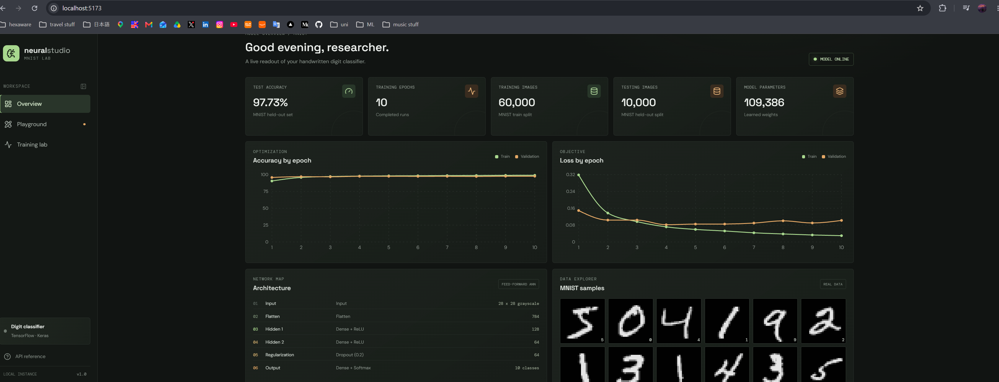

# Neural Studio

A local full-stack lab for handwritten digit recognition. The frontend is a React and TypeScript dashboard; the FastAPI backend trains and serves a TensorFlow/Keras artificial neural network using the real MNIST dataset.



## Features

- Draw digits with a mouse, pen, or touchscreen and view the model's ten class probabilities.
- MNIST-style preprocessing crops and scales the drawing into a centered, normalized 28 × 28 grayscale input.
- Dashboard charts show training and validation accuracy/loss from the actual training run, plus held-out test accuracy.
- Explore real MNIST image samples and the model's layer architecture.
- FastAPI health, prediction, metrics, model, and sample endpoints with explicit missing-artifact errors.

## Requirements

- Windows 10/11, 64-bit
- Python 3.12
- Node.js 20 or newer with npm
- Internet access on the first training run to download MNIST

TensorFlow runs on CPU by default. Training time depends on the machine. The trained model is generated locally and is intentionally not committed to source control.

## Setup on Windows PowerShell

Run these commands from the workspace root.

### 1. Create the Python environment

```powershell
py -3.12 -m venv .venv
Set-ExecutionPolicy -Scope Process -ExecutionPolicy Bypass
.\.venv\Scripts\Activate.ps1
python -m pip install --upgrade pip
pip install -r backend\requirements.txt
```

If `py -3.12` is unavailable, install Python 3.12 and select it as the interpreter in VS Code.

### 2. Train the network

Training downloads MNIST when needed, runs the specified 10 epochs with batch size 32 and a 20% validation split, evaluates the held-out test data, then writes the model and real training metrics.

```powershell
Set-Location backend
python -m app.ml.train
Set-Location ..
```

Generated files:

- `backend/models/neural_network.keras`
- `backend/training_history.json`

The metrics JSON is created only by a successful training run; no sample or fabricated chart values are included.

### 3. Start the backend

In a terminal with the virtual environment active:

```powershell
Set-Location backend
uvicorn app.main:app --reload --host 127.0.0.1 --port 8000
```

The API listens at `http://localhost:8000`, with interactive docs at `http://localhost:8000/docs`.

### 4. Start the frontend

Open a second terminal from the workspace root:

```powershell
Set-Location frontend
Copy-Item .env.example .env
npm install
npm run dev
```

Open `http://localhost:5173`.

## Environment variables

The frontend reads `VITE_API_URL` from `frontend/.env`. The backend reads `API_CORS_ORIGINS` as a comma-separated list; its default allows the two local Vite hostnames.

```dotenv
# frontend/.env
VITE_API_URL=http://localhost:8000/api
```

```dotenv
# backend/.env.example (set in the shell before starting Uvicorn if customized)
API_CORS_ORIGINS=http://localhost:5173,http://127.0.0.1:5173
```

To customize CORS in PowerShell before starting the backend:

```powershell
$env:API_CORS_ORIGINS = "http://localhost:5173,http://127.0.0.1:5173"
```

## API

| Method | Endpoint                        | Description                                                                                                          |
| ------ | ------------------------------- | -------------------------------------------------------------------------------------------------------------------- |
| `GET`  | `/api/health`                   | Backend status and whether the trained model loads                                                                   |
| `POST` | `/api/predict`                  | Multipart form field `image` (PNG, JPEG, or WebP, up to 5 MB); returns prediction, confidence, and ten probabilities |
| `GET`  | `/api/metrics`                  | Per-epoch training/validation metrics and held-out test results                                                      |
| `GET`  | `/api/model`                    | Layer descriptions, parameter count, and model load status                                                           |
| `GET`  | `/api/dataset/samples?limit=12` | Base64 PNG examples from the MNIST training split                                                                    |

If the model is absent, prediction returns HTTP 503 with the training command. Metrics also return HTTP 503 until training history exists. Invalid or blank drawings return HTTP 422.

## Project structure

```text
backend/
  app/
    ml/          Model definition, MNIST training, image preprocessing
    routes/      Prediction and metrics/model/dataset endpoints
    services/    Model loading and inference
  models/        Generated Keras model
frontend/
  src/
    components/  Canvas, results, charts, architecture, MNIST gallery
    pages/       Dashboard, playground, training lab
    services/    Typed API client
```

## Development checks

```powershell
# Frontend typecheck and production bundle
Set-Location frontend
npm run build

# Backend syntax check (from workspace root)
Set-Location ..
python -m compileall -q backend\app
```

## Notes

- Training must complete before prediction is available. Starting the API without a model is supported so health and model status remain inspectable.
- On first start, the MNIST sample endpoint may download the dataset. That download is cached by Keras for subsequent requests.
- The UI deliberately shows unavailable states instead of placeholder metrics when training has not run.
